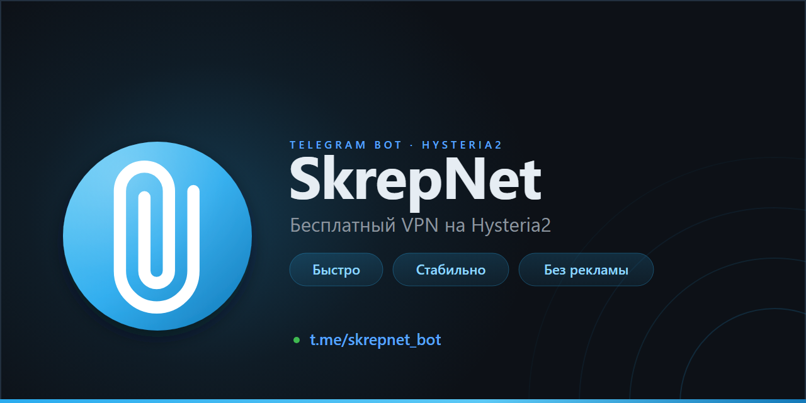

# Telegram VPN Bot

<p align="center">
  <a href="https://github.com/elbRUS62/telegram-vpn-bot/actions/workflows/ci.yml"></a>
</p>

<p align="center">
  
</p>

Telegram-бот для выдачи бесплатных подписок Hysteria2 через панель 3x-ui.  
В проект входят бот, Telegram Mini App, веб-выдача без Telegram, поддержка, мониторинг серверов и админ-панель.

Версия: `3.5.0`

Иконка и бренд: [brand/README.md](brand/README.md).
Для GitHub Social Preview использовать `brand/png/og-image-1200x630.png`.

Живой пример: [@skrepnet_bot](https://t.me/skrepnet_bot)

Проект можно использовать как шаблон: скопируйте репозиторий и настройте свой бот через `.env`.

## Возможности

### Для пользователей

- Получение бесплатной подписки Hysteria2.
- Согласие с правилами, политикой и пользовательским соглашением.
- Срок подписки 30 дней, лимит 3 IP одновременно.
- Ручное продление подписки без накрутки срока.
- QR-код и ссылка для подключения.
- Напоминания об окончании подписки.
- Реферальная система с автоодобрением приглашённых.
- Приглашение друга без Telegram через ссылку на сайт.
- Гостевая подписка на 3 дня с QR-кодом и без продления.
- Лист ожидания при достижении лимита пользователей.
- Донат через Telegram Stars и DonationAlerts.
- Инструкции для Android, iOS, Windows, macOS, Android TV и Linux.
- Обращения в поддержку прямо в Mini App.

### Mini App

- Личный кабинет внутри Telegram.
- Статус подписки, срок, трафик и онлайн-статус.
- QR-код, копирование ссылки, системное «Поделиться».
- Отдельная вкладка «Помощь» с тикетами.
- Донат и прогресс сбора.
- Пользовательские документы в модальных окнах.
- Нативная стилистика Telegram: тема, карточки, списки и кнопки.
- Без декоративных эмодзи в интерфейсе.

### Для админов

- Меню управления на inline-кнопках.
- Заявки, пользователи, поиск, сортировка и пагинация.
- Карточка пользователя: подписка, срок, трафик, комментарий, история.
- Одобрение, отклонение, продление, блокировка и удаление.
- Массовая рассылка и история действий.
- Админ-панель в Mini App с разделами «Обзор», «Пользователи» и «Система».
- Мониторинг нескольких панелей 3x-ui.
- Метрики CPU, RAM, диска, онлайна и трафика.
- Графики CPU, RAM, диска и расхода трафика за 24 часа и 7 дней с общей шкалой времени.
- Свайп между панелями с круговой прокруткой.
- Алерты по нагрузке, доступности API, Xray и сроку сертификата.
- Диагностика подключения для выбранного пользователя.
- Синхронизация данных с 3x-ui.
- Кнопка входа в панель 3x-ui только для админов.

### Веб-выдача без Telegram

- Гостевая ссылка на сайт.
- Срок действия ссылки 3 дня.
- Подписка на 3 дня без возможности продления.
- QR-код на странице.
- Жёлтая плашка с предупреждением о сроке.
- Автоматическое удаление гостевой подписки из базы и 3x-ui после окончания.
- Страница оформлена в стиле Mini App.

### Автоматика

- Напоминания о продлении каждый день в 10:00.
- Автоудаление неактивных пользователей через 30 дней.
- Очистка листа ожидания раз в месяц.
- Удаление гостевых веб-подписок после 3 дней.
- Очистка брошенных веб-выдач.
- Мониторинг 3x-ui каждые 5 минут.
- Бэкапы базы данных каждый день.
- Автозапуск через systemd.

## Архитектура

- Бот работает на VPS с прямым доступом к Telegram API.
- Панель 3x-ui может находиться на другом сервере.
- Связь с 3x-ui идёт по API-токену через HTTPS.
- Веб-сайт и Mini App работают на Flask под gunicorn.
- Mini App проверяет `initData` через HMAC-SHA256.
- Уведомления из Flask отправляются через Telegram Bot API по HTTP.
- Веб-процесс не импортирует `aiogram`.
- Мониторинг собирает метрики через API 3x-ui и хранит историю в SQLite.
- Тикеты и переписка хранятся в SQLite.

## Требования

- VPS для бота.
- Сервер с 3x-ui и Hysteria2.
- Python 3.10 или новее.
- API-токен 3x-ui.
- Бот в Telegram, созданный через BotFather.
- Токен DonationAlerts для приёма донатов.
- SSL-сертификат для сайта и Mini App.

## Установка

```bash
git clone https://github.com/elbRUS62/telegram-vpn-bot.git
cd telegram-vpn-bot

# Установка бота
bash scripts/install-bot.sh

# Установка сайта и Mini App
bash scripts/install-web.sh
```

Скрипт установки бота запросит:

- `BOT_TOKEN`
- `ADMIN_ID`
- `SUPERADMIN_ID`
- `BOT_USERNAME`
- `BOT_NAME`
- `SUPPORT_USERNAME`
- параметры 3x-ui
- `SUB_BASE_URL`
- лимиты и параметры донатов

После установки будут созданы `.env` с правами 600, виртуальное окружение, systemd-сервис и cron для бэкапов.

Скрипт установки сайта настроит gunicorn, проверит SSL и создаст отдельный сервис `skrepnet-web.service`.

### Полезные команды

```bash
systemctl status skrepnet-bot
systemctl status skrepnet-web
journalctl -u skrepnet-bot -f
journalctl -u skrepnet-web -f
systemctl restart skrepnet-bot
systemctl restart skrepnet-web
ls -la backups/
```

## Веб-админка

Отдельный раздел для работы с компьютера: `/admin`.

Вход без пароля:

1. Открой бота и отправь `/admin`.
2. Нажми «Веб-админка».
3. Перейди по одноразовой ссылке.

Ссылка действует 10 минут и используется один раз. Сессия хранится в защищённой cookie и живёт 12 часов.

В веб-админке доступны обзор, пользователи, тикеты, управление администраторами и аудит. Обычный админ не видит управление ролями и аудит.

Для работы нужен `WEB_SECRET_KEY`. Если он не задан, ключ выводится из токена бота; для продакшена лучше задать отдельный случайный ключ.

## Роли администраторов

Роли хранятся в таблице `admins`, а не только в `.env`.

- **Суперадмин** — полный доступ: пользователи, заявки, тикеты, статистика, рассылка, панель 3x-ui, диагностика, аудит и управление администраторами.
- **Админ** — заявки, пользователи, продление, блокировка, тикеты, статистика и мониторинг. Не может менять роли, делать рассылку, открывать панель 3x-ui, удалять пользователей и смотреть аудит.

`SUPERADMIN_ID` задаёт владельца и всегда остаётся суперадмином. Остальные администраторы добавляются в Mini App на вкладке «Админы» или в боте через «Управление → Админы». Назначение, повышение и понижение сопровождаются уведомлением в Telegram.

В списке пользователей у администраторов отображаются бейджи «админ» и «суперадмин».

## Бэкапы

`backup.sh` создаёт консистентную копию SQLite через Online Backup API, проверяет `PRAGMA integrity_check`, считает SHA-256 и сохраняет метаданные с количеством записей. Старые копии хранятся 30 дней.

Проверка восстановления:

```bash
./scripts/verify-backup.sh
```

Скрипт берёт последний бэкап, копирует его во временную папку, проверяет контрольную сумму, целостность и наличие обязательных таблиц. Проверка также запускается по cron 1-го числа каждого месяца в 06:00.

## Healthcheck и мониторинг

Публичные endpoint:

- `/health`
- `/healthz`

Они возвращают JSON и проверяют:

- доступность базы данных;
- свежесть heartbeat бота;
- последнее известное состояние панелей 3x-ui.

Если всё работает, ответ `200`. Если база недоступна, бот не обновлял heartbeat более 3 минут или панель не отвечала более 15 минут, ответ `503`.

Heartbeat бота обновляется раз в минуту через планировщик. На GB и RU установлен отдельный монитор: он проверяет `/health` раз в минуту, ждёт 5 минут непрерывной ошибки и отправляет алерт в Telegram, затем сообщает о восстановлении. Подробности: `docs/external-monitor.md`.

Для полной независимости добавлен внешний UptimeRobot: он проверяет `/health` снаружи каждые 5 минут и отправляет письмо при недоступности. ID монитора: `804404854`.

Подробная настройка offsite-бэкапов, UptimeRobot и технических алертов: `docs/backup-and-uptime.md`.

## Переменные .env

### Telegram

- `BOT_TOKEN` — токен бота от BotFather.
- `ADMIN_ID` — Telegram ID администраторов для первичного заполнения таблицы `admins`.
- `SUPERADMIN_ID` — Telegram ID владельца или список ID через запятую. Этот доступ всегда остаётся суперадминским.
- `WEB_SECRET_KEY` — секрет сессий веб-админки. Для продакшена задать случайное значение.
- `WEB_ADMIN_SESSION_HOURS` — срок жизни сессии веб-админки, по умолчанию 12 часов.
- `WEB_ADMIN_LINK_TTL_MINUTES` — срок жизни одноразовой ссылки входа, по умолчанию 10 минут.
- `BOT_USERNAME` — username бота без `@`.
- `BOT_NAME` — отображаемое имя бота.
- `SUPPORT_USERNAME` — username поддержки без `@`.

### 3x-ui

- `XUI_HOST` — адрес первой панели.
- `XUI_BASE_PATH` — путь первой панели.
- `XUI_API_TOKEN` — API-токен первой панели.
- `XUI_PANEL_ID` — ID первой панели, по умолчанию `ru`.
- `XUI_PANEL_NAME` — имя первой панели, по умолчанию `RU`.
- `XUI_VERIFY_TLS` — проверка TLS первой панели.
- `XUI2_HOST` — адрес второй панели.
- `XUI2_BASE_PATH` — путь второй панели.
- `XUI2_API_TOKEN` — API-токен второй панели.
- `XUI2_ID` — ID второй панели, по умолчанию `gb`.
- `XUI2_NAME` — имя второй панели, по умолчанию `GB`.
- `XUI2_VERIFY_TLS` — проверка TLS второй панели.
- `XUI_INBOUND_GB` — ID инбаунда Hysteria2.

### Подписка

- `SUB_BASE_URL` — базовый URL подписок.
- `SUB_PATH` — путь подписок.
- `LIMIT_IP` — лимит IP, по умолчанию 3.
- `SUBSCRIPTION_DAYS` — срок подписки, по умолчанию 30.
- `MAX_USERS` — максимум активных пользователей.

### Mini App и сайт

- `MINIAPP_URL` — URL Mini App.
- `WEB_BASE_URL` — базовый адрес сайта для ссылок.
- `WEB_PORT` — порт веб-сервера, по умолчанию 8443.
- `SSL_CERT` — путь к сертификату.
- `SSL_KEY` — путь к ключу.
- `WEB_SUBSCRIPTION_DAYS` — срок гостевой подписки, по умолчанию 3.

### Донаты

- `DONATE_URL` — ссылка DonationAlerts.
- `DONATE_TEXT` — текст блока донатов.
- `SERVER_COST` — стоимость сервера в рублях для прогресса.
- `DONATION_ALERTS_TOKEN` — токен DonationAlerts.

### Прочее

- `DB_PATH` — путь к базе данных.
- `BOT_VERSION` — версия бота.

## Структура проекта

```text
bot.py                  точка входа
config.py               чтение .env
database.py             совместимый фасад базы данных
db/                     модули SQLite: schema, users, invites, queries, donations, waitlist
xui_client.py           клиент 3x-ui
monitoring.py           метрики, история и алерты 3x-ui
scheduler.py            напоминания, очистка и мониторинг
keyboards.py            клавиатуры и меню
donation_socket.py      DonationAlerts через Centrifugo
web_app.py              Flask-приложение
backup.sh               бэкап базы

handlers/               обработчики бота
  menu.py               главное меню
  start.py              /start и deep-link
  subscription/         заявки, продление, QR, email-конфликты и лист ожидания
  invite.py             приглашения без Telegram
  admin/                админские обработчики: меню, статистика, заявки, пользователи, рассылка, панель
  donate.py             донаты
  connect.py            инструкции по платформам
  waitlist.py           лист ожидания
  web_link.py           привязка веб-пользователей
  progress.py           прогресс донатов

scripts/                установка бота и сайта
web/
  routes/               API, документы, приглашения, Mini App
  routes/api/           main, subscription, diagnostics, donate и другие API Mini App
  routes/api/admin/     админский API по модулям
  utils/                auth, async helper, HTTP-уведомления
  templates/            miniapp.html, invite.html, docs
  static/               miniapp.css, miniapp.js и общие стили

tests/                  smoke-тесты API, роутеров и статических файлов
```

## Как работает выдача подписки

### Обычный пользователь

1. Пользователь открывает бота и нажимает «Получить подписку».
2. Принимает правила, политику и соглашение.
3. Админ одобряет заявку.
4. Клиент создаётся в 3x-ui.
5. Пользователь получает ссылку и QR-код.
6. Дальше подписка управляется через Mini App.

### Реферал

1. Пользователь переходит по ссылке `start=ref_<id>`.
2. Бот сохраняет пригласившего.
3. После принятия условий заявка одобряется автоматически.
4. Пригласивший получает уведомление.

### Друг без Telegram

1. Пользователь нажимает «Гостевая подписка».
2. Бот создаёт гостевую ссылку на сайт.
3. Ссылку можно отправить через SMS, WhatsApp, VK или другой канал.
4. Друг открывает сайт, принимает условия и получает подписку на 3 дня.
5. Через 3 дня гостевая подписка удаляется из базы и 3x-ui.

### Лимит пользователей

1. При достижении лимита новый пользователь видит сообщение о нехватке мест.
2. Можно встать в лист ожидания.
3. Когда место освобождается, бот уведомляет первого из очереди.

## Безопасность

- `.env` не попадает в git, права 600.
- 3x-ui подключается по API-токену.
- Systemd настроен с автоперезапуском.
- Обязательные переменные проверяются при старте.
- `initData` в Mini App проверяется через HMAC-SHA256.
- Проверяется срок `auth_date`.
- Ссылка на панель 3x-ui выдаётся только администраторам.
- Для опасных действий есть подтверждение.
- В проекте включены Dependabot, CodeQL и secret scanning.

## Roadmap

- [x] Выдача подписок Hysteria2.
- [x] Одобрение админом и автоодобрение рефералов.
- [x] Продление и напоминания.
- [x] Реферальная система.
- [x] Веб-выдача без Telegram.
- [x] Гостевая подписка на 3 дня.
- [x] Telegram Mini App.
- [x] Тикеты поддержки.
- [x] Админ-панель в Mini App.
- [x] Мониторинг нескольких панелей 3x-ui.
- [x] Графики метрик и трафика.
- [x] Диагностика подключения для админов.
- [ ] Статистика донатов через API.
- [ ] Инструкции для Apple TV, Samsung TV и LG TV.
- [ ] Дальнейший рефакторинг крупных модулей.

## Лицензия

См. файл [LICENSE](LICENSE).
