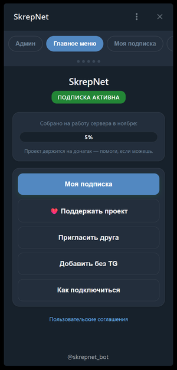
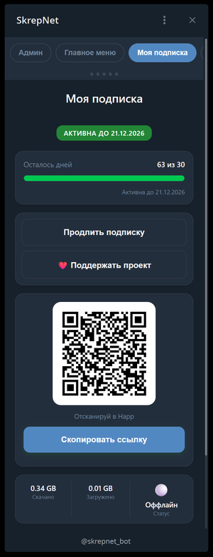
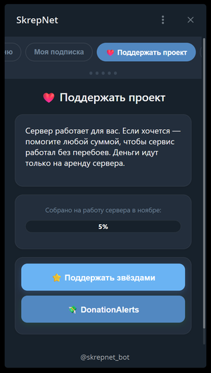
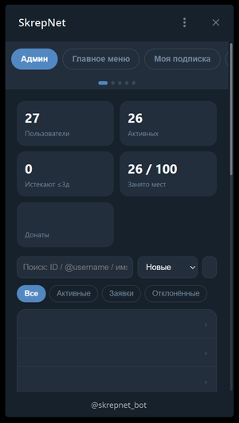

# 🛡️ Telegram VPN Bot

**Telegram-бот для выдачи бесплатных подписок Hysteria2 через панель 3x-ui, с реферальной системой, донатами, листом ожидания и веб-выдачей без Telegram.**

**Живой пример:** [@skrepnet_bot](https://t.me/skrepnet_bot) (BOT_NAME=`SkrepNet`, SUPPORT_USERNAME=`SkrepNet_support`).    
Это **шаблон** — разверните **свой** бот с **другим** именем, просто изменив `.env`.

## ✨ Возможности

### Для пользователей

- 📦 Получение подписки Hysteria2
- 📜 Согласие с правилами, политикой и пользовательским соглашением
- 📱 Лимит 3 IP одновременно, срок подписки 30 дней
- 🔄 Ручное продление подписки по кнопке (с защитой от накрутки)
- 📷 QR-код для быстрого подключения
- 🔔 Напоминания о продлении (за 3 дня и в день окончания, без звука)
- 📊 Прогресс сбора донатов (полоска в `/start` и напоминаниях)
- 👥 Реферальная система: рефералы одобряются **автоматически**
- ➕ **Приглашение без Telegram** — «👤 Выбрать из контактов» + одноразовая ссылка (7 дней)
- 🔗 **Автопривязка веб-пользователей** — B просто открывает бота и жмёт Start, бот сам находит подписку по TG ID
- 📋 Лист ожидания, если достигнут лимит пользователей
- 💰 Донат: Telegram Stars + DonationAlerts
- 📖 Инструкции для 6 платформ (Android, iOS, Windows, macOS, Android TV, Linux)
- 🍎 Happ — рекомендуемое приложение
- 🎫 **Обращения в поддержку** прямо в Mini App: история переписки, ответы админа, уведомления в Telegram

### Для админов

- 🛠 Меню «Управление» — всё на inline-кнопках
- 📋 Список заявок с карточкой пользователя (одобрение, отклонение, удаление)
- 👥 Список пользователей с пагинацией и сортировкой (кириллица → латиница)
- 🔄 Обновление подписки (выбор из списка, ввод дней)
- 🗑 Удаление пользователей (из БД и 3x-ui одновременно)
- ♻️ Сброс заявки
- 📢 Рассылка всем активным
- 📊 Расширенная статистика: пользователи, лист ожидания, свободные места, топ-5 приглашающих
- 🔐 Кнопка входа в панель 3x-ui
- 📝 Комментарии к клиентам в 3x-ui (TG ID, username, источник, счётчик продлений)
- 💬 Лист ожидания с автоуведомлением при освобождении места
- ❌ Кнопка «Отмена» во всех FSM-сценариях (рассылка, продление, комментарии, email)
- 📈 **6-я карточка «Трафик»** — накопительный, из 3x-ui (asyncio.gather, ~1–2 сек)
- 🔽 **Кастомный select сортировки** (`admin-sort`) — тёмный, работает в Android (не системный белый)
- 🎨 **CSS-кружки статуса** — green (active) пульсирует наружу 8s, yellow/red/gray — внутрь 3.5s
- 🪟 **Админка полупрозрачная** + светлая тема
- ↔️ **Фильтры в строку** со скроллом (не переносятся на 2-ю строку)
- 🔄 **SVG-иконка синхронизации** (`admin-sync`, вместо пустой кнопки)

### Telegram Mini App (WebApp)

- 🌐 **Полноценный личный кабинет** внутри Telegram
- 📊 **Главное меню**: статус подписки, прогресс донатов, быстрые действия
- 🔐 **Моя подписка**: QR-код, ссылка на подписку, прогресс-бар дней (с плавным изменением цвета), трафик (скачано/загружено), статус онлайн/оффлайн
- 🛡️ **Защита от накрутки**: продление не дальше 30 дней от текущей даты
- 🔄 **Умное фоновое обновление**: каждые 3 секунды проверяет изменения и обновляет данные только при необходимости
- 💰 **Донат**: Telegram Stars (выбор суммы: 10, 50, 100, 500) и DonationAlerts
- 🎚️ **Свайп-слайдер** «Получить подписку» — тянется вправо, откат при <85%, модалка условий при ≥85%
- ☑️ **Кастомный чекбокс условий** — пульсация, галочка при :checked
- 💰 **Донат звёздами**: 4 суммы (10/50/100/500 звёзд) + «Своя сумма» (1–10000) + «Отмена»
- 🌈 **Фон Mini App** — градиент (синий/фиолетовый), плавающие точки, свечение сверху
- 🪟 **Табы-«стекло»** (glass) — полупрозрачные + `backdrop-filter: blur(16px)`, фон виден сквозь
- 🔤 **Единый шрифт** — `button, input, select, textarea { font-family: inherit; }`
- 🪟 **Модалки в едином стиле** — `rgba+blur`, `overflow-y: auto`, `backdrop: rgba(0,0,0,0.4)`
- ✨ **Splash screen** — подзаголовок «Твой интернет», линия, точки, радиальный градиент
- 🆘 **Техподдержка**: тикеты внутри Mini App (создание, переписка, закрытие) + прямая ссылка на @SkrepNet_support
- 📜 **Документы**: правила, политика, соглашение (в модальных окнах)
- 👥 **Реферальная система**: ссылка для приглашения, счётчик друзей

### Админ-панель в Mini App (v3.1+)

- 📊 **Статистика**: пользователи, активные, заявки, донаты
- 📋 **Список заявок** с кнопками «Одобрить» / «Отклонить»
- 👥 **Список пользователей** с поиском, сортировкой и фильтрами
- 🗂 **Карточка пользователя**: имя, @username, ID, email, трафик, комментарий из 3x-ui, дни до окончания
- 🔄 **Продление** (+30 дней) и **удаление** пользователей
- ⛔ **Блокировка / разблокировка** (enable: false в 3x-ui)
- 🔘 **Точки-индикатор** вкладок (плавный скролл)
- 🔐 **Кнопка «Панель 3x-ui»** — admin-only переход в панель в браузере; ссылка выдаётся API только после проверки `init_data` и `ADMIN_IDS` и не хранится в общем шаблоне
- 🖥 **Карточка мониторинга 3x-ui** — CPU, RAM, диск, Xray, uptime, срок сертификата, задержка API, онлайн-клиенты и трафик
- 🎫 **Тикеты поддержки** — список активных/закрытых обращений, переписка с пользователем, ответ и закрытие

### Веб-выдача без Telegram (v3.2+)

- 🔗 **Многоразовая ссылка**: можно открывать многократно, но подписка выдаётся 1 раз
- 📷 **При повторном открытии** — QR-код существующей подписки
- ⏱ **Срок подписки**: 3 дня (WEB_SUBSCRIPTION_DAYS)
- 🎨 **Дизайн в стиле Mini App**: те же цвета, шрифты, кнопки
- 📜 **Документы в модалке**: правила, политика, соглашение (без перехода на внешний сайт)

### Веб-сайт (для выдачи подписки без Telegram)

- 🌐 Flask-приложение на HTTPS (порт 8443), запуск через gunicorn
- 🔗 Одноразовые ссылки-приглашения (7 дней, срабатывают 1 раз)
- ✅ Согласие с документами → мгновенная выдача подписки
- 📷 QR-код прямо на странице
- 📚 **Документы на сайте** (`/docs/rules`, `/docs/privacy`, `/docs/terms`)
- ➡️ Кнопка «Открыть бота» для привязки

### Автоматика

- ⏰ Напоминания о продлении — ежедневно в 10:00 (без звука)
- 🗑 Автоудаление неактивных (30+ дней) — ежедневно в 4:00
- 📋 Автоочистка листа ожидания (30+ дней) — 1-го числа каждого месяца
- 🧹 **Автоочистка «брошенных» веб-выдач** (30+ дней) — ежедневно в 5:00
- 🖥 **Мониторинг 3x-ui** — каждые 5 минут: CPU/RAM/диск, Xray, сертификат, доступность API
- 🚨 **Алерты админам** — при недоступности панели, перегрузке CPU/RAM/диска, остановке Xray и скором истечении сертификата
- 💾 Бэкапы базы данных — ежедневно в 3:00, хранение 30 дней
- 🔧 Systemd-автозапуск (Restart=always)
- 🔌 DonationAlerts WebSocket через Centrifugo (экспоненциальный ретрай + уведомления админам)

## 📸 Скриншоты

| Главное меню | Моя подписка |
|:---:|:---:|
|  |  |

| Поддержать проект | Админ-панель |
|:---:|:---:|
|  |  |

---

## 🏗️ Архитектура

- **Бот** работает на зарубежном VPS (прямой доступ к Telegram API)
- **Панель 3x-ui** — на российском VPS
- Связь между ними — через **API-токен (Bearer)** по HTTPS
- **Веб-сайт** (`web_app.py`, `gunicorn.conf.py`) — Flask под gunicorn на HTTPS, отдельный порт
- **Mini App** — Flask на HTTPS, валидация `initData` (HMAC-SHA256, WebAppData, BOT_TOKEN, `auth_date` TTL 1 час)
- **Донаты** — Telegram Stars + DonationAlerts через Centrifugo WebSocket
- **Мониторинг** — `monitoring.py` опрашивает `/panel/api/server/status`, `/panel/api/inbounds/list` и `/panel/api/clients/onlines`, кэширует результат на 15 секунд
- **Тикеты** — `support_tickets` + `support_messages` в SQLite, админские и пользовательские API в Mini App
- **Уведомления из Flask** — `httpx` напрямую в Telegram Bot API в фоновом потоке, без импорта `aiogram` в веб-процессе

## 📋 Требования

- VPS за рубежом (для бота)
- VPS с 3x-ui + Hysteria2 (для панели)
- Python 3.10+
- API-токен 3x-ui (Settings → Security → API Tokens)
- Бот в Telegram (создаётся через @BotFather)
- Токен DonationAlerts (для приёма донатов)
- SSL-сертификат для веб-сайта и Mini App (например, Let's Encrypt)

## 🚀 Быстрая установка

    git clone https://github.com/elbRUS62/telegram-vpn-bot.git
    cd skrepnet-bot

    # Установка бота
    bash scripts/install-bot.sh

    # Установка веб-сайта и Mini App (опционально)
    bash scripts/install-web.sh

Скрипт задаст все вопросы (BOT_TOKEN, ADMIN_ID, BOT_USERNAME, BOT_NAME, SUPPORT_USERNAME, XUI_HOST, XUI_API_TOKEN, инбаунд, SUB_BASE_URL, лимиты, донат) и настроит бота автоматически: создаст `.env` с правами 600, поставит зависимости в venv, настроит cron для бэкапов и systemd-сервис.

Для веб-сайта: `scripts/install-web.sh` настроит gunicorn-сервис, проверит SSL, при необходимости получит сертификат через certbot и создаст отдельный `skrepnet-web.service`.

### Полезные команды

    systemctl status skrepnet-bot      # статус
    journalctl -u skrepnet-bot -f      # логи в реальном времени
    systemctl restart skrepnet-bot     # перезапуск
    ls -la backups/                    # бэкапы

## 🔧 Переменные `.env`

### Telegram

- `BOT_TOKEN` — токен бота от @BotFather
- `ADMIN_ID` — Telegram ID админов (через запятую)
- `BOT_USERNAME` — username бота (без @)
- `BOT_NAME` — **отображаемое имя бота** (по умолчанию `SkrepNet`). Используется во всех текстах, комментариях 3x-ui и как **имя группы** в 3x-ui
- `SUPPORT_USERNAME` — username поддержки (без @, по умолчанию `SkrepNet_support`)

### 3x-ui

- `XUI_HOST` — адрес панели 3x-ui
- `XUI_BASE_PATH` — путь панели
- `XUI_API_TOKEN` — API-токен
- `XUI_INBOUND_GB` — ID инбаунда Hysteria2

### Подписка

- `SUB_BASE_URL` — базовый URL подписок
- `SUB_PATH` — путь подписок
- `LIMIT_IP` — лимит IP (по умолчанию 3)
- `SUBSCRIPTION_DAYS` — срок подписки в днях (по умолчанию 30)
- `MAX_USERS` — максимум активных пользователей (по умолчанию 100)

### Mini App

- `MINIAPP_URL` — URL Mini App (например, `https://gb-skrepnet.duckdns.org:8443/v3`)

### Донаты

- `DONATE_URL` — ссылка на DonationAlerts
- `DONATE_TEXT` — текст плашки
- `SERVER_COST` — стоимость сервера в ₽/мес (для прогресса сбора)
- `DONATION_ALERTS_TOKEN` — токен DonationAlerts (для WebSocket)

### Веб-выдача (v3.2+)

- `WEB_SUBSCRIPTION_DAYS` — срок веб-подписки (по умолчанию 3 дня)
- `MINIAPP_URL` — URL Mini App (для кнопки в боте)
- `WEB_PORT` — порт веб-сервера (по умолчанию 8443)
- `SSL_CERT` — путь к fullchain.pem
- `SSL_KEY` — путь к privkey.pem

### Прочее

- `DB_PATH` — путь к базе данных (по умолчанию `skrepnet.db`)
- `BOT_VERSION` — версия бота (по умолчанию `3.4.5`)

## 📁 Структура проекта

    bot.py                  # точка входа
    config.py               # чтение .env, валидация
    database.py             # SQLite (users, tickets, monitoring, invite_links, invites, donations, waitlist)
    xui_client.py           # API 3x-ui (clients, comment, online, server status, inbounds)
    monitoring.py           # Мониторинг 3x-ui: метрики, сертификат, алерты и кулдауны
    keyboards.py            # кнопки и меню
    scheduler.py            # напоминания + автоочистка + мониторинг 3x-ui
    docs_config.py          # ссылки на документы в telegra.ph
    donation_socket.py      # DonationAlerts через Centrifugo WebSocket
    web_app.py              # Flask-приложение (тонкий вход)
    backup.sh               # бэкап базы
    handlers/               # обработчики по модулям
    ├── menu.py             # главное inline-меню, back_to_main, menu_* callback
    ├── web_link.py         # автопривязка по TG ID (handle_web_link, bind_by_tg_id)
    ├── start.py            # /start, deep-link (ref_*, link_*)
    ├── subscription.py     # заявка, одобрение, продление, QR, лист ожидания
    ├── donate.py           # Stars + DonationAlerts
    ├── connect.py          # инструкции для 6 платформ
    ├── admin.py            # меню «Управление», статистика
    ├── invite.py           # приглашения без Telegram («Выбрать из контактов»)
    ├── progress.py         # прогресс сбора донатов
    ├── waitlist.py         # уведомление следующего из очереди
    ├── states.py           # FSM-состояния
    └── utils.py            # sanitize_email, QR-генератор
    scripts/                # install-bot.sh, install-web.sh
    web/                    # Flask-роуты и Mini App
    ├── routes/             # api, docs, invite, miniapp
    │   └── api/            # main, admin.py, support.py (тикеты)
    ├── utils/              # auth.py (initData), async_helper.py, telegram.py (HTTP-уведомления)
    └── templates/
        ├── miniapp.html    # Mini App: подписка, донаты, тикеты, админка, мониторинг
        ├── docs.html
        └── docs/
            ├── rules.html
            ├── privacy.html
            └── terms.html
    web/static/style.css    # стили (в т.ч. Mini App)

## 🔄 Как работает выдача подписки

### Обычный пользователь

1. `/start` → «📦 Получить подписку»
2. Принятие правил, политики и соглашения
3. Админ жмёт «✅ Одобрить» → клиент создаётся в 3x-ui, пользователь получает ссылку
4. Управление подпиской (QR, продление) — через **Mini App** («📱 Личный кабинет»)

### Реферал (по ссылке `?start=ref_<id>`)

1. `/start` по deep-link → автоматически записывается `invited_by`
2. Принятие правил, политики и соглашения → **автоодобрение**
3. Админ и пригласивший получают уведомление

### Друг без Telegram (веб-выдача)

1. A → «➕ Добавить без Telegram» → **«👤 Выбрать из контактов»**
2. Telegram открывает список контактов → A выбирает B
3. Бот получает **TG ID + username** B → создаёт одноразовую ссылку `/invite/<token>`
4. A отправляет ссылку B (SMS / WhatsApp / голосом)
5. B (без VPN) открывает ссылку на сайте → принимает условия → получает QR + подписку
6. B подключается к VPN через Happ
7. B открывает `@skrepnet_bot` → жмёт **Start** — бот **автоматически** находит подписку по TG ID и **привязывает**
8. B становится **обычным пользователем** → может продлевать через бота

**Никаких токенов вручную.** B просто открывает бота.

### Если достигнут лимит пользователей

1. Новый пользователь видит «⚠️ Свободных мест нет»
2. Может встать в **лист ожидания** (кнопка «📝 Встать в лист ожидания»)
3. Когда место освобождается → бот уведомляет первого из очереди

## 🔒 Безопасность

- `.env` в `.gitignore`, права 600
- API-токен 3x-ui вместо логина/пароля
- Systemd с `Restart=always`
- Валидация обязательных переменных при старте (`config.py`)
- **Валидация initData** в Mini App: HMAC-SHA256 (WebAppData, BOT_TOKEN), `compare_digest`, проверка `auth_date` (TTL 1 час)
- **Same-Origin Restriction** в BotFather (только ваш домен может читать initData)
- **Жёсткая проверка TG ID** при автопривязке — только тот B, для кого создана ссылка
- Dependabot, CodeQL, Secret scanning — включены

## 🗺️ Roadmap

- [x] Выдача подписок Hysteria2
- [x] Одобрение админом
- [x] Автоодобрение рефералов
- [x] Ручное продление
- [x] Напоминания
- [x] Реферальная система + топ-5
- [x] Приглашения без Telegram (веб-выдача)
- [x] Донат: Stars + DonationAlerts
- [x] Прогресс сбора донатов
- [x] Инструкции для 6 платформ
- [x] Меню «Управление»
- [x] Соглашение с пользователем
- [x] Автоудаление неактивных
- [x] Лимит пользователей + лист ожидания
- [x] Счётчик продлений в comment 3x-ui
- [x] Настраиваемое имя бота (`BOT_NAME`)
- [x] **Inline-меню** вместо ReplyKeyboard
- [x] **Документы на сайте** (`/docs/*`)
- [x] **Автопривязка веб-пользователей по TG ID**
- [x] **Автоочистка брошенных веб-выдач**
- [x] **Отмена во всех FSM-сценариях**
- [x] **Telegram Mini App (v3.0)** — личный кабинет с подпиской, донатом, поддержкой
- [x] **Фоновое обновление в Mini App** — каждые 3 секунды (только при изменениях)
- [x] **Защита от накрутки продления** — не дальше 30 дней от сегодня
- [x] Онлайн-клиенты (статус онлайн/оффлайн)
- [x] **Мониторинг панели 3x-ui** — метрики, алерты и карточка в админке Mini App
- [x] **Тикеты поддержки** в Mini App — переписка, ответы админа, уведомления
- [ ] Статистика донатов через API
- [ ] Инструкции для Apple TV, Samsung TV, LG TV
- [ ] UTC вместо MSK для `used_at`
- [x] Админ-панель в Mini App (статистика, заявки, пользователи, блокировка)
- [x] Кнопка «Панель 3x-ui» в админке Mini App (admin-only)
- [x] Многоразовая ссылка для веб-выдачи (3 дня)
- [x] Дизайн invite.html в стиле Mini App
- [ ] Рефакторинг всего проекта (разбить `admin.py`, `subscription.py`, `keyboards.py`, `database.py` на модули)
- [x] **Свайп-слайдер** «Получить подписку» (v3.2.10)
- [x] **Кастомный чекбокс условий** (v3.2.10)
- [x] **Донат звёздами** + «Своя сумма» (1–10000) + «Отмена» (v3.2.10)
- [x] **Фон Mini App** — градиент, точки, свечение (v3.2.10)
- [x] **Табы-«стекло»** (glass, blur) (v3.2.10)
- [x] **Единый шрифт** (`inherit` для form-элементов) (v3.2.10)
- [x] **Модалки — единый стиль** (rgba+blur, backdrop 0.4) (v3.2.10)
- [x] **6-я карточка «Трафик»** (накопительный, asyncio.gather) (v3.2.10)
- [x] **Кастомный select сортировки** (тёмный в Android) (v3.2.10)
- [x] **CSS-кружки статуса** — green наружу / yellow-red-gray внутрь (v3.2.10)
- [x] **Админка** — полупрозрачная, светлая тема, фильтры в строку (v3.2.10)
- [x] **`.screen max-width: 100%`** (десктоп) (v3.2.10)
- [x] **Splash screen** Mini App (v3.2.10)
- [ ] Функция переименования клиента в 3x-ui через бота (с синхронизацией БД)

## 📌 Версия

**Текущий релиз: v3.4.5**

Мониторинг 3x-ui, тикеты поддержки и HTTP-уведомления входят в v3.4.5 — см. [CHANGELOG.md](CHANGELOG.md).

История версий — в [CHANGELOG.md](CHANGELOG.md).

@elbRUS62
